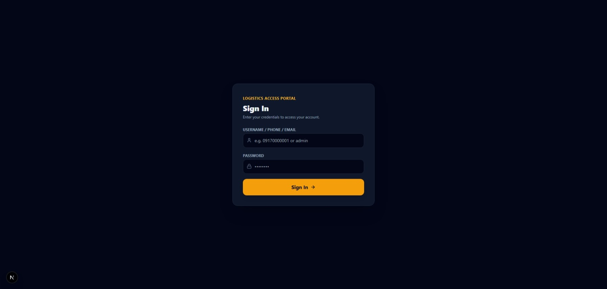
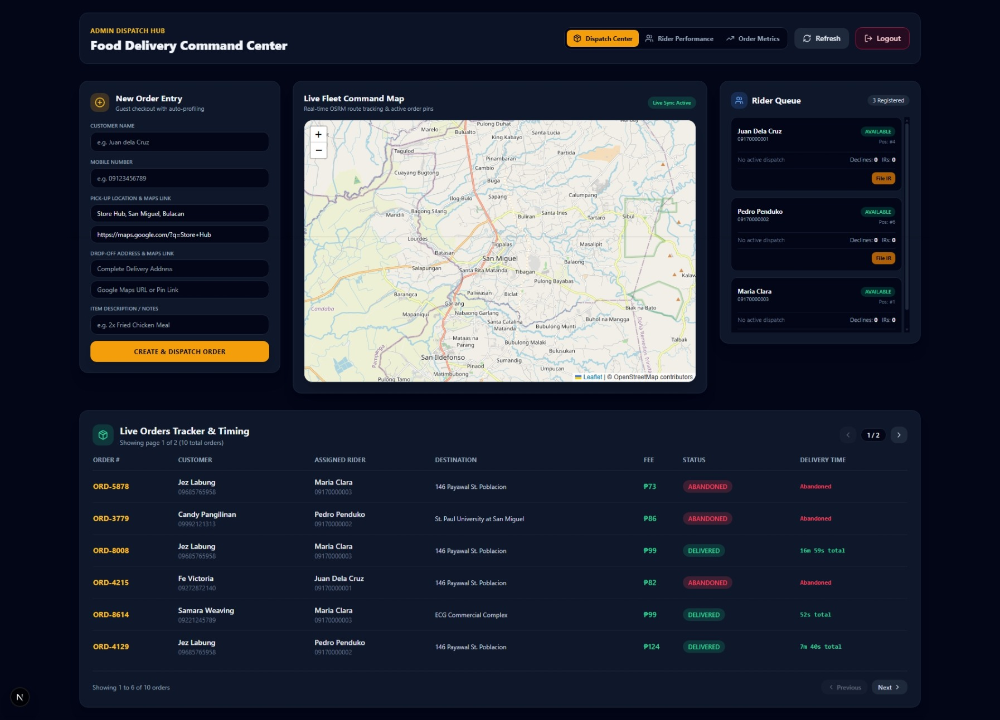
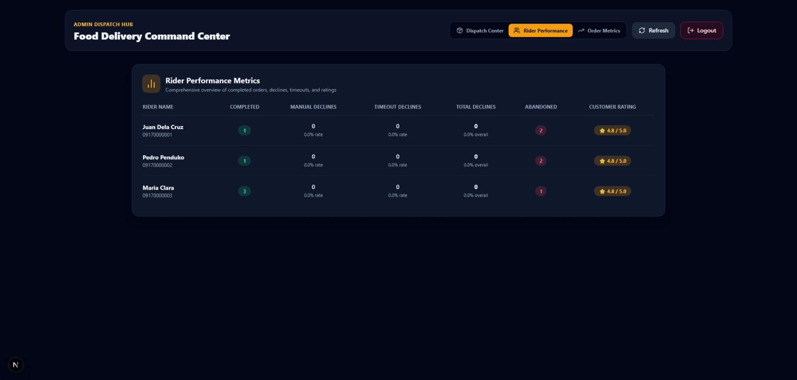
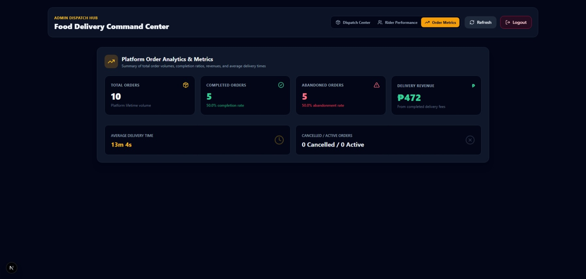
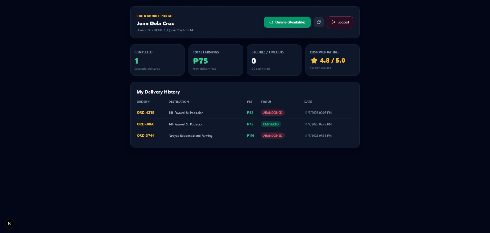

# 🛵 LocalFleet: Self-Hosted Food Delivery Dispatch Platform

A high-performance, real-time, multi-tenant food delivery dispatch and fleet management platform built for localized operations. Designed with a custom FIFO queue engine, live OSRM spatial routing, automated state timeouts, and a sleek dark-mode admin command center.

## 🛠️ Tech Stack

* **Framework:** Next.js 16 (App Router)
* **Language:** TypeScript
* **Database & ODM:** MongoDB & Mongoose
* **Mapping & Routing:** Leaflet.js, CartoDB Dark Matter, and OSRM (Open Source Routing Machine)
* **Styling:** Tailwind CSS & Lucide Icons
* **State & Real-Timeing:** Polling architectures, automated background cron jobs, and live delivery timers.

---

## 📸 Platform Previews & Screenshots

### 1. Authentication & Security
Secure credential login for administrators and fleet riders.


### 2. Admin Command Center (`/admin/dashboard`)
The central 3-column dispatch hub featuring the New Order Entry form, Live Fleet Command Map with CartoDB dark tiles, and Rider FIFO Queue, accompanied by the paginated live orders tracker below.


### 3. Rider Performance Tracking
Comprehensive overview tracking completed orders, manual and timeout declines, incident reports, and customer ratings.


### 4. Platform Order Analytics & Metrics
High-level operational metrics summarizing total order volumes, completion ratios, revenues, and average delivery turnaround times.


### 5. Rider Mobile Portal (`/rider/dashboard`)
Mobile-optimized portal for status toggling, earnings tracking, and OSRM live route navigation with exact pick-up and drop-off pins.


---

## 🚀 Core Features

### 1. Admin Command Center
* **3-Column Dispatch Layout:** High-density arrangement for rapid order entry, spatial fleet monitoring, and queue compliance management.
* **Paginated Orders Tracker:** Real-time table tracking active, completed, and abandoned deliveries with live elapsed timing.
* **Compliance & Incident Management:** Integrated tracking for rider declines, timeout limits, and manual Incident Report (IR) filings with quick suspension toggles.

### 2. Rider Mobile Portal
* **Status Toggling:** Switch seamlessly between Online (Available), Offline, and Busy on Delivery states.
* **Live OSRM Route Navigation:** Embedded Leaflet maps rendering exact pick-up/drop-off pins and route polylines extracted dynamically from OSRM geometry payloads.
* **Step-by-Step State Lifecycle:** Guided status progression workflow (`Arrived at Store` $\rightarrow$ `Picked Up & En-Route` $\rightarrow$ `Arrived at Drop-off` $\rightarrow$ `Delivered`).

### 3. Automated Backend Cron & Cron Jobs
* **Offer Timeouts:** Automatically catches expired order offers, increments rider decline metrics, and re-queues unaccepted orders.
* **Abandonment Protection:** Prevents deadlocks by transitioning abandoned or unresponsive orders into clear operational alert states.

---

## 📂 Project Structure

```text
├── app/
│   ├── admin/dashboard/       # Admin Command Center & Analytics tabs
│   ├── rider/dashboard/       # Mobile rider portal & live navigation
│   └── api/                   # Next.js API endpoints (orders, rider actions, crons)
├── components/
│   ├── AdminCommandMap.tsx    # Multi-rider Leaflet fleet tracking map
│   └── RiderMap.tsx           # Single-order OSRM route visualization map
├── lib/
│   ├── db.ts                  # Mongoose connection utility
│   ├── models/                # MongoDB schemas (Order, User/Rider, etc.)
│   └── jobs/                  # Background cron jobs (checkStaleOrders, etc.)
└── package.json
```

---

## ⚙️ Getting Started & Installation

1. **Clone the repository:**
   ```bash
   git clone https://github.com/YOUR_USERNAME/your-repo-name.git
   cd your-repo-name
   ```

2. **Install dependencies:**
   ```bash
   npm install
   ```

3. **Configure Environment Variables:**
   Create a `.env.local` file in the root directory and add your MongoDB connection string:
   ```env
   MONGODB_URI=your_mongodb_connection_string_here
   JWT_SECRET=your_secret_key_here
   ```

4. **Run the Development Server:**
   ```bash
   npm run dev
   ```
   Open [http://localhost:3000](http://localhost:3000) in your browser to view the application.

---

## 📄 License
Distributed under the MIT License. See `LICENSE` for more information.